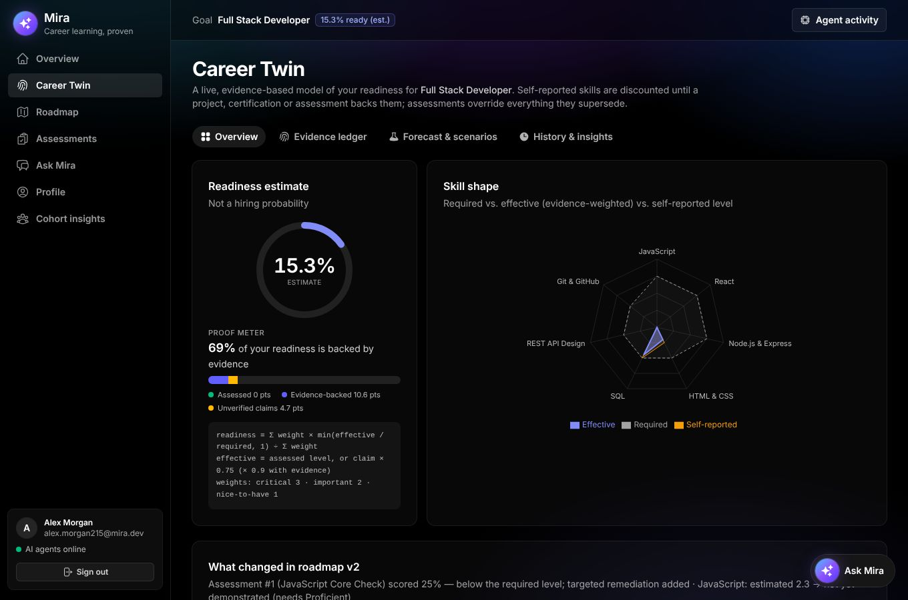
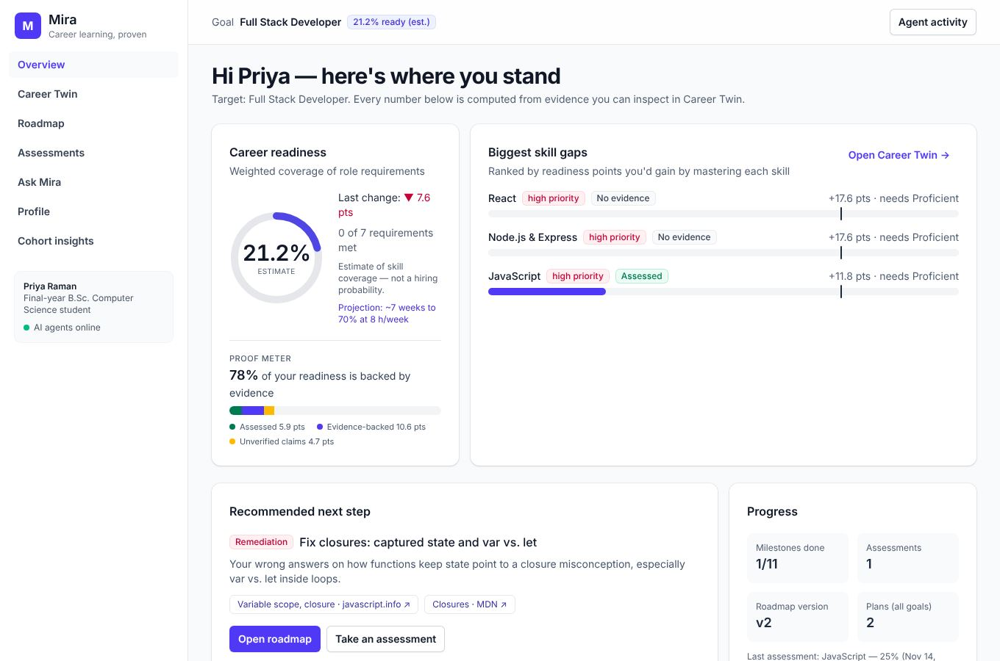
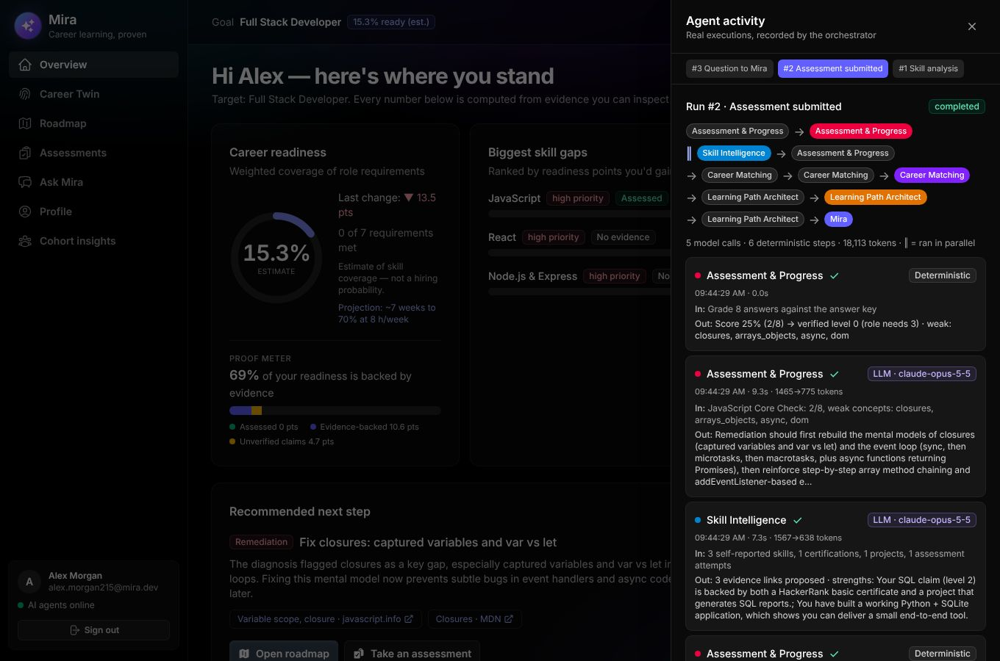
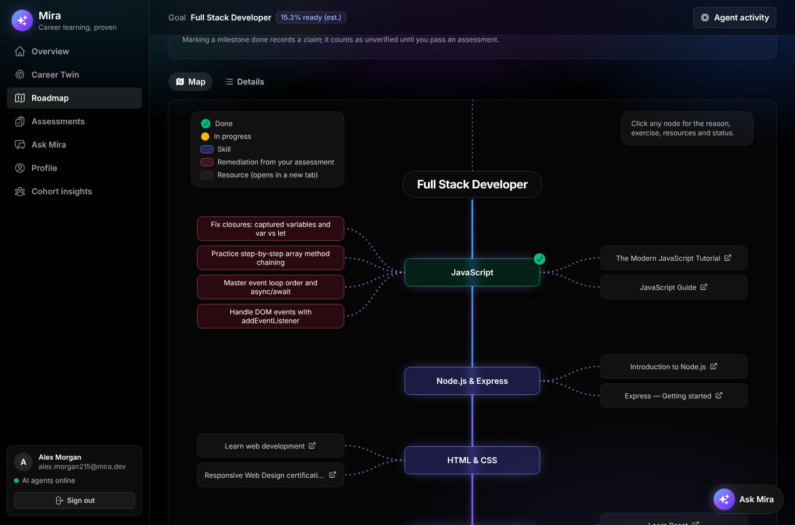
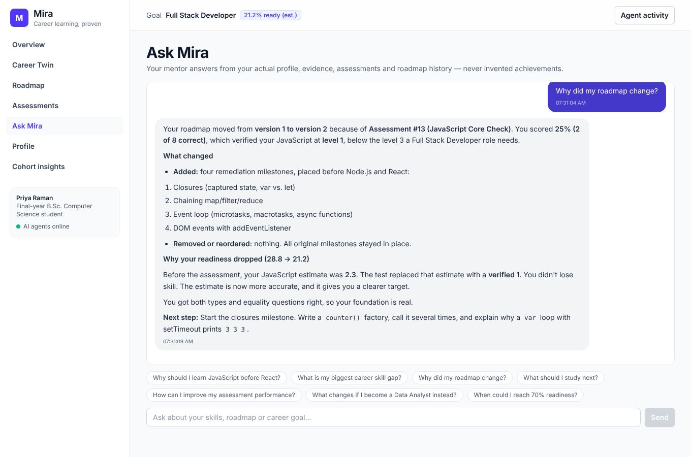
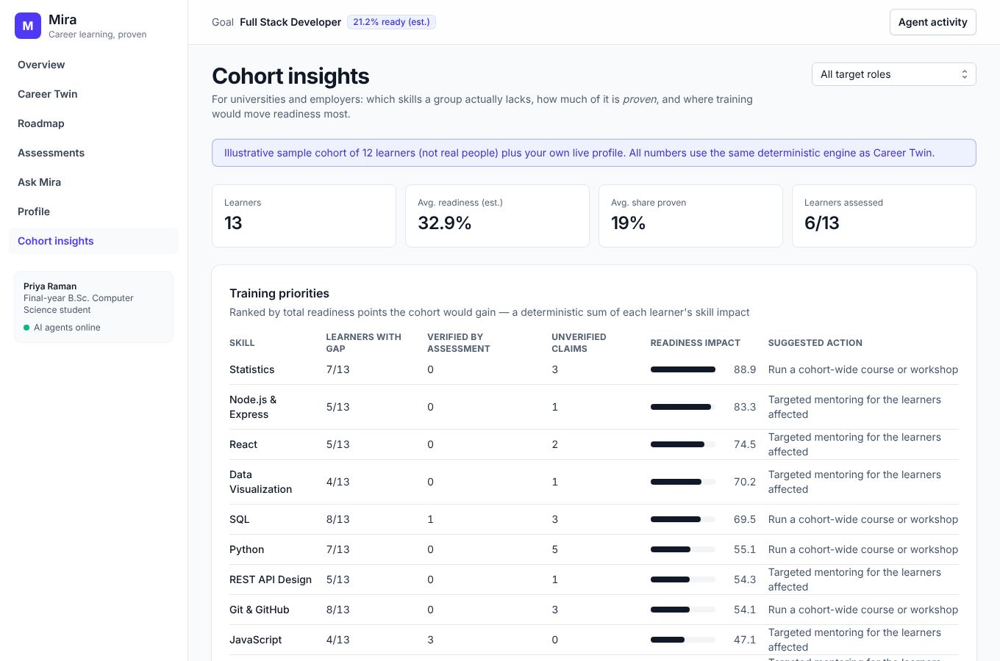
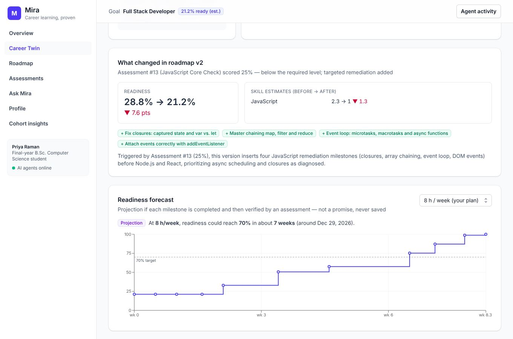
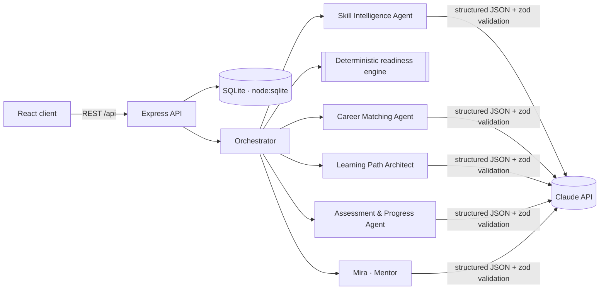

# Mira — evidence-based career learning, built by a team of AI agents

> *Mira sees what you really know — and aims you where you want to go.*
> Repository: **SkillFocus** · Built for **PromptWars × Rathinam Technical Campus**

Mira is an AI-powered learning platform that works out a learner's **real** skill level, compares it with a target career, and builds a personalised roadmap. **Five specialised AI agents** collaborate on that roadmap, and it **adapts automatically** when the learner fails an assessment or changes their goal.



| Overview | Agent activity (real runs) |
|---|---|
|  |  |
| **Adapted roadmap (v2)** | **Ask Mira (grounded mentor)** |
|  |  |
| **Cohort insights (universities & employers)** | **Readiness forecast (projection)** |
|  |  |

*Screenshots are from a real run of the demo scenario: live agent calls and a JavaScript assessment deliberately answered at 2/8.*

---

## Chosen vertical

**Education & career development: a personalised AI learning platform.**
*Persona:* a student or employee who knows their target role but not their real gaps. One example is a CS student with Python, SQL and basic HTML who wants to become a Full Stack Developer. Universities and L&D teams are the secondary users: they want validated skill gaps rather than self-reported ones.

## The problem, and our answer

Traditional platforms hand everyone the same courses and never check whether a skill is real. Mira's core idea is that **completing a course is a claim, not proof.**

| Expected feature | How Mira delivers it |
|---|---|
| User profile | Editable learner details, background, self-rated skills, certifications, projects, interests, weekly hours, career goal (validated, persisted in SQLite) |
| Skill analysis | **Skill Intelligence Agent** links certifications and projects to skills as evidence and names strengths, weaknesses and uncertainties; a deterministic engine weights each skill by its evidence |
| Career matching | Explicit, weighted requirements for 3 roles (Full Stack Developer, Data Analyst, AI/ML Engineer); **Career Matching Agent** explains the gaps and the critical path |
| Learning recommendations | **Learning Path Architect** writes milestones with reasons, practical exercises and effort, choosing resources **only from a curated catalog of real, free resources** |
| Progress tracking | Milestone status, assessment attempts, skill-estimate changes, readiness history, and every roadmap revision kept with a diff |
| AI mentor | **Mira** answers from a grounded snapshot of the learner's real data and explains why the roadmap changed |
| Organisation view (problem statement: *"organizations and universities find it difficult to identify what skills … lack"*) | **Cohort insights** aggregate evidence-based gaps across learners: training priorities ranked by total readiness impact, how many gaps are assessment-verified vs. unverified claims, and a suggested action per skill (workshop, assess first, or targeted mentoring) |
| Adaptive multi-agent behaviour | A failed assessment or a goal change triggers a new agent run and a **new roadmap version**, with a visible before/after |

## The differentiator: Career Twin

Career Twin is a transparent, evidence-based model of the learner's readiness for a role:

- **Evidence ledger.** Every skill estimate traces back to its source: a self-report, a completed milestone (a *claim*), a project or certification linked by the Skill Intelligence Agent, or an **assessment attempt**.
- **Confidence levels.** Each estimate is labelled *Unverified* (×0.75), *Evidence-backed* (×0.9) or *Assessed* (the verified level, which overrides earlier claims).
- **Explainable readiness.** `readiness = Σ weight × min(effective / required, 1) ÷ Σ weight`, with weights critical 3, important 2, nice-to-have 1. Each skill's **impact** is the number of readiness points it would add if mastered, which drives prioritisation. The figure is always labelled an *estimate, not a hiring probability*.
- **Proof meter.** Splits the readiness estimate into *assessed*, *evidence-backed* and *unverified* points using the same formula, so a learner can see at a glance how much of their readiness is actually proven.
- **Before/after comparison.** Each roadmap revision stores a snapshot, so the UI shows readiness and per-skill changes, plus the milestones that were added, removed or reordered.
- **Readiness forecast (unique).** A deterministic, week-by-week projection: walking the pending roadmap at the learner's weekly study hours, when could readiness reach 70% if each milestone is completed *and verified*? A study-time simulator (4–20 h/week) recomputes it instantly. Mira uses it to answer "When could I reach 70%?". It is labelled a projection, never a promise, and is never saved.
- **What-if simulator.** Previews readiness if you mastered selected skills. It uses the same engine on the client and **never writes to the database**.
- **Goal comparison.** The same evidence is evaluated against all three roles. Switching goal keeps all history.

**Signature flow (reproducible in the demo):**
1. The learner marks *JavaScript* done. The claim raises readiness a little, but the estimate stays unverified.
2. They take the JS assessment and score 2/8, so the verified level is 1. Readiness **drops**.
3. Four agents re-run, and roadmap **v2** inserts targeted remediation (closures, async, …) **before React**.
4. Mira explains the change by citing the actual attempt.

## How it works



### Agents

Each agent is a separate model call with its own instructions and typed, schema-validated output.

| Agent | Deterministic part | AI part (validated) |
|---|---|---|
| Skill Intelligence | Builds the evidence table | Links certifications and projects to catalog skill IDs (unknown skills and invented evidence are rejected); strengths, weaknesses, uncertainty |
| Career Matching | Gap analysis, readiness, impact, prerequisite order | Headline, critical path (restricted to real gaps), per-skill notes |
| Learning Path Architect | Slot order: prerequisites (topological sort) and remediation placement | Milestone titles, reasons, exercises, effort; resources **only from each slot's whitelist** |
| Assessment & Progress | Grading against the answer key, per-concept results, verified level, adaptation rule | Diagnosis of misconceptions and the remediation focus passed to the Path Architect |
| Mira (Mentor) | Grounded learner snapshot | Conversational guidance; told never to invent scores, courses or achievements |

### Orchestrated flows (no loops; at most 5 model calls per action)

| Trigger | Agents in order |
|---|---|
| Analyze / profile saved | Skill Intelligence → engine → **(Career Matching ‖ Path Architect, in parallel)** → new revision → Mira summary |
| Assessment submitted | deterministic grading → **(Assessment & Progress ‖ Skill Intelligence re-assessment)** → engine → (Matching ‖ Path Architect) → revision v+1 → Mira summary |
| Goal changed | history kept → engine → (Matching ‖ Path Architect) → revision for the new role → Mira summary |

The **Agent activity** drawer shows each run as it executes: agent, status, timestamp, duration, model, tokens, input and output summaries, and errors. LLM calls, deterministic steps and rule-based fallbacks are labelled differently.

### Approach and logic

1. **The AI reasons; it never computes the numbers.** Readiness, levels, scores and impact come from a pure, unit-tested engine (`shared/engine.ts`), so every number can be reproduced from the UI.
2. **Every AI output is checked against known data.** Responses use the API's structured output, are re-validated with zod, and are then cross-checked against the catalogs: skill IDs, resource IDs, gap lists, and the learner's real certifications and projects.
3. **Graceful degradation.** If the model is unavailable, the step is logged as *failed*, the deterministic engine and rule-based templates keep the app usable, and the UI says so. Fallback output is never shown as an AI result.
4. **History is append-only.** Roadmap revisions and assessment attempts are never overwritten, so goal changes and adaptations stay auditable.

## Cohort insights (universities & employers)

`GET /api/cohort?role=all|<roleId>` runs the same deterministic engine over a group of learners. It returns average readiness, the average share of readiness that is proven, and **training priorities**: for each skill, how many learners have the gap, how many gaps are verified by an assessment versus resting on unverified claims, and the readiness points the cohort would gain. The demo uses an **illustrative sample cohort of 12 learners (not real people)** plus the live learner, and the UI labels it that way.

## Assumptions

- A single-learner prototype with no authentication. A preloaded demo learner and a reset button keep the demo reproducible.
- Role requirements are **illustrative benchmarks**, not universal hiring standards.
- Skills use a 0–4 scale (None, Basic, Working, Proficient, Advanced).
- Score bands map to levels: <20% → None, 20–39% → Basic, 40–69% → Working, 70–89% → Proficient, ≥90% → Advanced. Any concept scored below 50% is "weak". After an attempt the learner sees an answer review, so retakes of the same assessment have a cooldown (`MIRA_RETAKE_COOLDOWN_MIN`, default 10 minutes), and a new attempt resets that skill's remediation progress.
- Assessments are short multiple-choice checks (JavaScript: 8 questions; SQL: 5; Python: 6) graded deterministically. No free-text AI grading.
- The resources are a curated set of 48 well-known free resources. Links were checked when the catalog was built; a few sites block automated checks.

## Run it locally

Requires **Node ≥ 22.13** (uses the built-in `node:sqlite`).

```bash
npm install
cp .env.example .env        # set ANTHROPIC_API_KEY (server-side only)
npm run dev                 # API on :8090, web on http://localhost:5173
```

Production: `npm run build && npm start`, which serves the built client and the API on one port. To host under a sub-path, set `MIRA_BASE_PATH=/Mira` both when building and when running.

| Variable | Default | Purpose |
|---|---|---|
| `ANTHROPIC_API_KEY` | — | Claude API key (never sent to the browser) |
| `MIRA_MODEL` / `MIRA_EFFORT` | `claude-opus-5-5` / `low` | Model and effort for all agents |
| `PORT` / `HOST` | `8090` / `0.0.0.0` | Listen address (use `127.0.0.1` behind a proxy) |
| `MIRA_BASE_PATH` | *(empty)* | Optional sub-path, e.g. `/Mira` |
| `MIRA_DB_PATH` | `data/mira.db` | SQLite file |

## Testing

```bash
npm test             # 36 unit + API tests: engine, grading, roadmap assembly, AI-output validation,
                     # input validation, security headers, cohort analytics, and the no-AI rule-based fallback
npm run acceptance   # 3 end-to-end acceptance tests against a running server (real agent runs)
npm run check        # typecheck + unit tests + production build
```

The acceptance tests cover the three required scenarios:

1. **Profile → roadmap.** Gaps are found with JS before React, readiness matches the engine, at least 3 LLM agents complete, every resource comes from the catalog, and Mira explains the prerequisite.
2. **Assessment → adaptation.** The score is exactly 25%, weak concepts match the wrong answers, JS becomes assessed at level 1, readiness drops, remediation is placed before React, the diff is recorded, and Mira cites the attempt.
3. **Career change → persistence.** A Data Analyst plan is created while the Full Stack history, the attempts and the certifications/projects are all kept; `npm run acceptance -- persist` re-checks after a server restart.

## Security

- The API key lives only on the server, loaded from `.env` or the environment, and is never logged. `.env` is git-ignored.
- **Input validation:** every input is checked with zod (profile, goal, answers, milestone status, chat). The JSON body limit is 100 kB and skill entries are de-duplicated.
- **Answer keys** never reach the client before an attempt; only the post-attempt review shows correct answers, and retakes are rate-limited by a cooldown.
- **Untrusted input:** learner text is treated as data. Catalog lookups use prototype-free tables, so IDs like `__proto__` or `toString` are simply unknown. Model outputs are whitelisted against the catalogs and never executed.
- **Headers:** CSP, `nosniff`, `X-Frame-Options: DENY`, `Referrer-Policy`, `Permissions-Policy`.
- **Limits:** per-client rate limit on AI endpoints, plus timeouts and a bounded retry on model calls.
- **Production hardening:** a systemd unit with a dedicated user and a sandbox (`ProtectSystem=strict`, `NoNewPrivileges`).

## Efficiency

- Matching and Path Architect run **in parallel**. Only the agents an event needs are invoked, with no agent loops, and effort is set to `low`.
- Agents receive compact JSON summaries, never the full history.
- Run history loads in two queries (runs, then all their steps), with indexes on the hot lookups.
- Agent runs are asynchronous: the API returns a `runId` immediately and the UI polls one small endpoint.
- The charting library loads only with Career Twin (a separate chunk), keeping the initial JavaScript at about 130 kB gzipped.

## Accessibility

- **Headless UI** provides the accessible behaviour for interactive primitives: the Agent activity panel is a modal `Dialog` (focus trap, Escape, `aria-modal`, scroll lock) and quiz answers use `RadioGroup` (roving focus, arrow keys). They are styled like the dark headlessui.com examples (black canvas with a purple/blue glow, translucent `white/5` surfaces, `white/10` rings, Inter): `Dialog`, `RadioGroup`, `Listbox`, `Disclosure`, `Checkbox`, `Field`/`Input`/`Textarea`.
- **Ask Mira from anywhere:** a floating launcher (Headless UI `Popover`) opens the grounded mentor chat on every page. Replies render as GitHub-flavoured Markdown (`react-markdown` + Tailwind Typography), and raw HTML in model output is never rendered.
- Heroicons (by Tailwind Labs) label navigation and key actions; decorative icons are `aria-hidden`.
- Semantic landmarks, a skip-to-content link, and visible focus rings.
- Labelled form controls; radio-group quizzes; `aria-pressed` on milestone status buttons; a live region in the chat.
- Respects `prefers-reduced-motion`.
- An automated **axe-core** audit (WCAG 2 A/AA rules) reports **0 violations** across all seven views. Muted text and status colours were darkened so they meet the 4.5:1 contrast ratio.
- Responsive layout down to mobile, and colour is never the only signal (labels and icons accompany it).

## Deployment

See `deploy/`: `deploy.sh` (install or update under `/opt/mira`), `mira.service` (systemd), `nginx-mira.conf` (an nginx `location /Mira/` block), and a `Caddyfile` alternative.

## Project structure

```
shared/   types, catalog (skills, roles, resources), deterministic readiness engine
server/   Express API, SQLite store, grading, roadmap assembly, orchestrator, agents/
client/   React + Vite + Tailwind UI (views/, components/)
tests/    unit tests (node:test)        scripts/  end-to-end acceptance tests
deploy/   systemd, nginx, Caddy, deploy script        docs/  plan & demo script
```

## Known limitations

- Single learner, no authentication or multi-tenant admin dashboard yet.
- Three assessment banks so far (JavaScript, SQL, Python). Other skills rely on self-reports, claims or evidence until assessed.
- An agent run takes about 20–40 s with real model calls; the live activity drawer shows progress while it runs.
